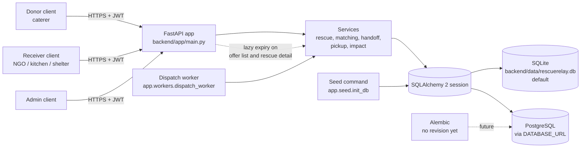
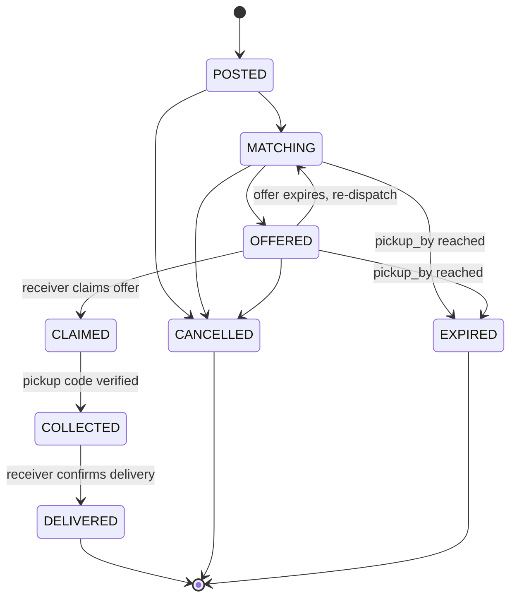

# RescueRelay architecture

This document gives a brief overview of the components and the rescue lifecycle. For setup, see [HOW_TO_RUN.md](../HOW_TO_RUN.md). For the live API, see Swagger at `http://localhost:8000/docs` when the server is running.

## Components

- **FastAPI app:** routes for authentication, rescues, offers, handoffs, pickup and donor impact. Authentication uses JWT tokens.
- **Services:** business logic for rescues, matching and dispatch, claims and handoffs, pickup and delivery, and impact.
- **Database:** SQLAlchemy 2 models. SQLite by default; PostgreSQL when `DATABASE_URL` is set.
- **Dispatch worker:** re-offers rescues whose offers have expired. Can run as a loop or once with `--once`.
- **Seed command:** creates the tables and demo data.
- **Frontend and Docker:** not built yet.

## Rescue state machine

- **POSTED:** the donor has created the rescue.
- **MATCHING:** feasible receivers are being ranked.
- **OFFERED:** an offer is pending with the top-ranked feasible receiver.
- **CLAIMED:** a receiver has claimed the offer. The exact address and donor phone become visible to that receiver.
- **COLLECTED:** the pickup code was verified at collection.
- **DELIVERED:** the receiver confirmed delivery. Only delivered servings count toward impact.
- **EXPIRED** and **CANCELLED** are terminal side branches.

The diagram shows the intended lifecycle. Only creation through OFFERED and CLAIMED has been verified manually; collection, delivery and the expiry/re-dispatch paths are not yet verified.

## Atomic claim

A receiver claims a pending offer with a single conditional update: the offer changes to claimed only if it is still pending and still belongs to that receiver. If the update matches no row, the claim fails. A second claim on the same offer therefore returns 409 `OFFER_NOT_PENDING`, and a receiver who was not offered the rescue receives 404.

Because the decision is made in one database statement, two simultaneous claims cannot both succeed. A concurrency test for this has been written but not yet executed.
